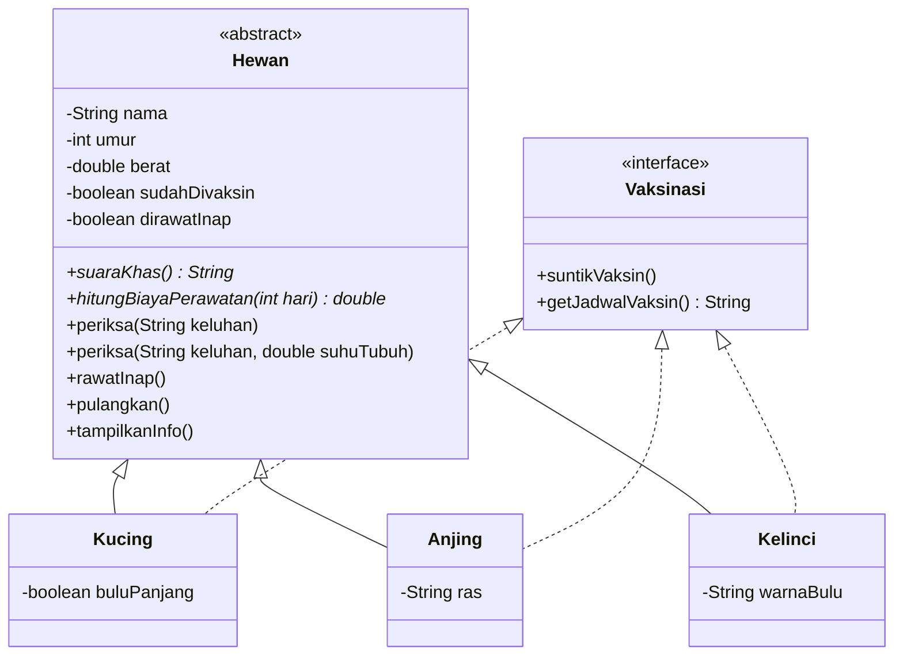

# Sistem Klinik Hewan (Pet Care)

Program Java berbasis konsol untuk mengelola pasien di sebuah klinik hewan. Program ini dibuat untuk memenuhi tugas **Praktik Lab Session 3B: Pengembangan Program Berbasis Object-Oriented Programming (OOP)** dan menerapkan konsep Encapsulation, Inheritance, Polymorphism, Abstract Class, dan Interface.

## Deskripsi Studi Kasus

Sebuah klinik hewan menangani beberapa jenis pasien, yaitu kucing, anjing, dan kelinci. Setiap hewan memiliki data dasar (nama, umur, berat), suara khas, dan cara perhitungan biaya perawatan yang berbeda. Klinik juga memberikan layanan vaksinasi untuk setiap hewan.

Fitur yang tersedia:

- Menampilkan data pasien
- Menampilkan suara khas masing-masing hewan
- Pemeriksaan hewan (dengan atau tanpa data suhu tubuh)
- Rawat inap dan pemulangan pasien
- Perhitungan biaya perawatan sesuai jenis hewan
- Pengubahan data hewan dengan validasi
- Vaksinasi dan jadwal vaksin

## Struktur Program

| File | Jenis | Keterangan |
|---|---|---|
| `Vaksinasi.java` | Interface | Kontrak layanan vaksinasi |
| `Hewan.java` | Abstract class | Superclass yang menyimpan data dan perilaku umum hewan |
| `Kucing.java` | Subclass | Turunan `Hewan`, mengimplementasikan `Vaksinasi` |
| `Anjing.java` | Subclass | Turunan `Hewan`, mengimplementasikan `Vaksinasi` |
| `Kelinci.java` | Subclass | Turunan `Hewan`, mengimplementasikan `Vaksinasi` |
| `Main.java` | Main class | Menjalankan simulasi sistem |

## Diagram Kelas



## Penerapan Konsep OOP

### 1. Encapsulation
Atribut pada setiap class dideklarasikan `private` dan diakses melalui getter dan setter. Setter memiliki validasi agar data tetap valid, misalnya berat harus lebih dari 0 dan umur tidak boleh negatif. Status rawat inap hanya bisa berubah lewat method `rawatInap()` dan `pulangkan()`.

```java
public void setBerat(double berat) {
    if (berat > 0) {
        this.berat = berat;
    } else {
        System.out.println("Berat harus lebih dari 0!");
    }
}
```

### 2. Inheritance
`Hewan` adalah superclass, sedangkan `Kucing`, `Anjing`, dan `Kelinci` adalah subclass yang memakai keyword `extends`. Constructor subclass memanggil constructor superclass dengan `super(...)`.

```java
public class Kucing extends Hewan implements Vaksinasi {
    public Kucing(String nama, int umur, double berat, boolean buluPanjang) {
        super(nama, umur, berat);
        this.buluPanjang = buluPanjang;
    }
}
```

### 3. Polymorphism
- **Overriding**: subclass menimpa method dari superclass dengan anotasi `@Override`, seperti `suaraKhas()`, `hitungBiayaPerawatan()`, dan `tampilkanInfo()`.
- **Overloading**: method `periksa()` memiliki dua versi dengan parameter berbeda, yaitu `periksa(String keluhan)` dan `periksa(String keluhan, double suhuTubuh)`.
- **Runtime polymorphism**: objek `Kucing`, `Anjing`, dan `Kelinci` disimpan dalam `ArrayList<Hewan>`. Saat method dipanggil, versi milik subclass yang dijalankan.

```java
ArrayList<Hewan> daftar = new ArrayList<>();
daftar.add(new Kucing("Mochi", 2, 4.2, true));
daftar.add(new Anjing("Bruno", 4, 30.5, "Labrador"));
daftar.add(new Kelinci("Snowy", 1, 1.8, "Putih"));
```

### 4. Abstract Class
`Hewan` adalah abstract class dengan dua abstract method, yaitu `suaraKhas()` dan `hitungBiayaPerawatan(int hari)`. Ketiga subclass wajib mengimplementasikannya dengan cara masing-masing.

| Hewan | Aturan biaya perawatan |
|---|---|
| Kucing | Rp 50.000 per hari, ditambah Rp 30.000 jika berbulu panjang (grooming) |
| Anjing | Rp 70.000 per hari, ditambah Rp 20.000 per hari jika berat lebih dari 25 kg |
| Kelinci | Rp 35.000 per hari, diskon 10% jika dirawat 5 hari atau lebih |

### 5. Interface
`Vaksinasi` adalah interface yang berisi `suntikVaksin()` dan `getJadwalVaksin()`. `Kucing`, `Anjing`, dan `Kelinci` mengimplementasikannya dengan `implements` dan memenuhi kontrak kedua method tersebut.

## Cara Menjalankan

### Menggunakan NetBeans
1. Buka NetBeans, pilih **File → Open Project**, lalu pilih folder project ini.
2. Pastikan semua file `.java` berada di dalam satu package yang sama.
3. Klik kanan `Main.java`, lalu pilih **Run File** (Shift + F6).

### Menggunakan terminal
```bash
javac *.java
java Main
```

## Contoh Output

```text
===== SISTEM KLINIK HEWAN =====

--- SUARA PASIEN ---
Mochi : Meong~
Bruno : Guk guk!
Snowy : (mendengus pelan dan menghentakkan kaki)
Coco : Guk guk!

--- PEMERIKSAAN ---
Pemeriksaan Mochi dengan keluhan: Bersin-bersin
Pemeriksaan Bruno dengan keluhan: Lesu dan tidak mau makan (suhu tubuh 40.1 C)
  Catatan: suhu tinggi, disarankan rawat inap.

--- UBAH DATA LEWAT SETTER ---
Berat lama: 1.8 kg
Berat harus lebih dari 0!
Berat baru: 2.1 kg
```

Contoh di atas hanya sebagian output. Format angka pada biaya (pemisah ribuan) mengikuti pengaturan locale komputer.

## Pembuat

- **Nama**: Naisya Ramadhani
- **NIM**: L0325047
- **Program Studi**: Informatika (Kelas B, PSDKU)
- **Universitas**: Universitas Sebelas Maret
